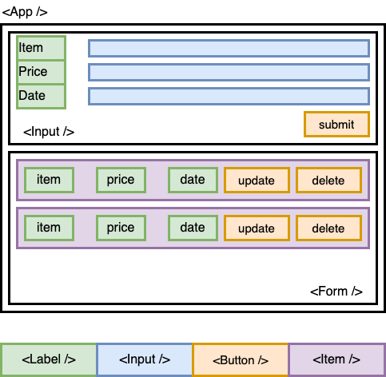

<h1>
  
  Create Expense App Lab
</h1>

Welcome, you are about to create your first React app from scratch.

## About 

In this lab, you will create a create an Expense app which will look like this.

You will learn how to reuse components in your app with different data and different functionality and add items to state, read and also update.

You are to build 7 components only and reuse them to get the look of the app.

## Prerequisites

- React Components
- State Management (including props)
- Lifting State

## Time to complete

You are required to complete this during lesson time and submit it before you leave for the day.

## Content

- [Setup](./setup/README.md)
- [Exercise](./exercise/README.md)

## Solution code (Todo?)

🏁 [Solution code](https://github.com/ga-curriculum/react-components-lab-solution)

## Internal resources

✏️ [Instructor Guide](./internal-resources/instructor-guide.md)

🏗️ [Release Notes](./internal-resources/release-notes.md)

---

**Find a 👾 bug 👾 or have suggestions? [Let us know](https://ga-curriculum.github.io/universal-resources-internal/module-feedback.html)!**
