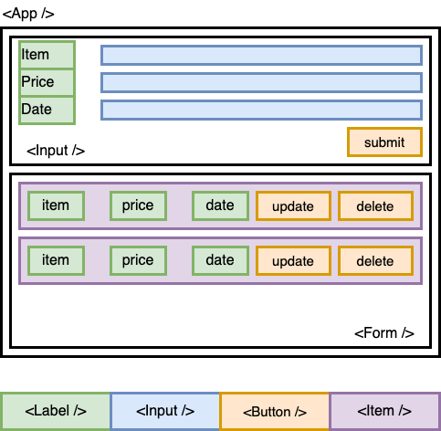

# 

## Overview

In this lab, you'll build an app that does CRD and reuses components.


## Wireframe

You are to base the app on the wireframe outlined below.<br/>
<br />



## Requirements

The app with be built with 6 components:
- Input
- Form
- Label
- Input
- Button
- Item

You are allowed to name the components any name you see fit.

## Functionality

The app will 
- expenses are to be stored in state
- item name, price and date are to be stored
- able to CREATE, READ and DELETE the items in the state

## Sample Code to Start You Off

```javascript
// Reusable Button component partial codes
const Button = (props) => {
  return (
    <button className={`btn ${props.className}`} 
      type="button" onClick={props.onClick}>

		{props.children}

	</button>
  )
}
```

## What is props.children

```javascript
// Partial Parent components to explain props.children
const Parent = (props) => {
  return (
    <Button>
      // Any jsx, Components, text, etc. here will be passed to the Button child       // as props.children. props.children is create automatically.
    </Button>
  )
}
```

## Helpful Date Codes

If you want to use today's date as the default

## Main Objective

In this lab, you will learn how to reuse components, changing their look and functionality depending on what was prop'ed.

## Level Up

- If you want to use today's date as the default, you can try using these codes

```javascript
const currentDate = new Date().toISOString().split("T")[0]
const [date, setDate] = useState(currentDate)
```

- Try adding the EDIT functionality
